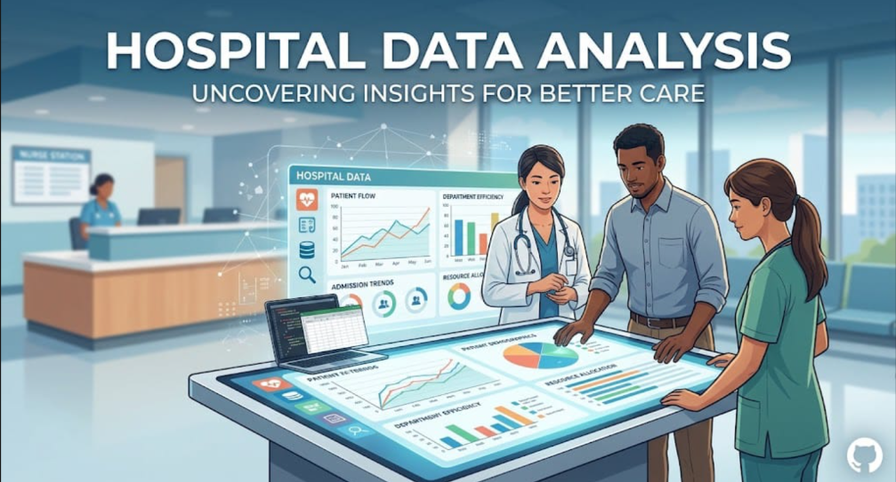
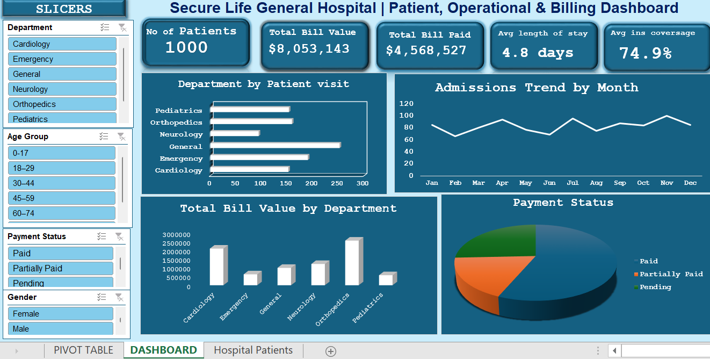

# Secure Life General Hospital Patient Operational Billing-Dashboard

## INTRODUCTION

I am currently completing a 3-month mentorship at FadaQa Tech Scholarship, and this is the first project assigned to me.
Secure Life General Hospital wants a consolidated view of patient admissions, billing, insurance coverage, and payment status. 
The purpose of this analysis is to turn the supplied visit-level records into an interactive Excel dashboard that helps management monitor patient volumes, 
department activity, length of stay, bill values, payment-status mix, and insurance coverage
Note: This dashboard is designed strictly for operational and financial monitoring. It is not a clinical-quality assessment and does not establish treatment outcomes.

## About the dataset

The supplied workbook contains one worksheet named “Hospital Patients”. It has 1,000 records and 11 columns. The data dictionary describes Patient ID as the record/visit identifier and explicitly states that each row represents one patient visit; a person may appear in multiple rows

## Problem Statement

Secure Life General Hospital records thousands of data points on patient visits, departments, diagnoses, length of stay, insurance coverage and billing. At present this data is held in a raw spreadsheet, which makes it hard for management to see how the hospital is performing.
Management cannot easily tell:
Which departments receive the most visits and which generate the most revenue.
How much of the billed amount has been paid, and how much is Pending or Partially Paid?
How admissions and billing change over time.
Which age groups and diagnoses drive demand, length of stay and cost.
How much insurance coverage contributes to bills?

## Objective: 

Analyze the Hospital Patients dataset (1,000 records) in Excel, using pivot tables and an interactive dashboard with slicers, to answer the 12 management questions and give evidence-based insights and recommendations.
## Scope:

 Visit volume, department performance, billing and payment status, length of stay, insurance coverage, age and gender analysis, and monthly admission trends.
 
## Expected outcome: 

A single dashboard that lets hospital management monitor performance, find revenue and collection risks, and plan staffing and resources.

## VISUALIZATION 

## KEY INSIGHTS
Decoupled Workload and Revenue Drivers: The hospital's operational workload and financial performance are driven by completely different units. General and Emergency carry the heaviest patient traffic, while Orthopedics and Cardiology act as the primary financial engines due to high-value procedures.
Significant Revenue Collection Gap: Out of $8.05M in total billing, only $4.57M is marked as fully paid. A substantial portion of hospital revenue remains tied up in Pending and Partially Paid accounts, posing a major cash-flow risk.
High Patient Out-of-Pocket Exposure: With insurance covering an average of 74.9% of medical bills, patients are responsible for roughly 25.1% of costs out of pocket. High co-pays or uncovered balances likely contribute to the high rate of partially paid and pending bills.
Predictable Seasonal Fluctuations: Patient admissions follow a manageable rhythm throughout the year. However, the recurring dips in February and June represent underutilized hospital capacity.

## KEY FINDINGS (SUMMARY)

**Total Patient Volume (Q1)**
 - The hospital recorded 1,000 total patient visits.

**Visits by Department (Q2)**:
      - General (255 visits) and Emergency (200 visits) account for the highest patient traffic.
      - Orthopedics, Pediatrics, and Cardiology follow closely (155–165 visits each),
      - while Neurology recorded the lowest volume (130 visits).
      - 
**Revenue by Department (Q3)**:
      - Orthopedics ($2.7M) and Cardiology ($2.1M) generate the highest total bill values.
      - Neurology and General sit in the middle ($1.1M–$1.2M each),
      - while Emergency and Pediatrics generate the lowest total billing ($0.5M–$0.6M each).
        
**Length of Stay (Q1)**:
      - The overall average length of stay is 4.8 days.

**Payment Status Mix (Q5)**:
      - Paid bills represent the largest share (roughly half or more of all visits),
      - while Partially Paid and Pending accounts each make up roughly one-fifth. 

**Billing & Uncollected Revenue (Q6)**:
      -Total billed revenue is $8,053,143. Of this amount, $4,570,000 has been fully paid.

**Insurance Coverage & Demographics (Q7, Q8, Q9)**:
      -Overall average insurance coverage stands at 74.9%.

**Monthly Admission Trends (Q10)**:
     - Monthly admissions remain relatively steady between 65 and 100 visits, with slight seasonal dips in February and June and peaks in April, July, and October.

**Volume vs. Revenue Alignment (Q11)**:
     - High patient volume does not translate to high revenue.
     - General and Emergency handle the highest traffic with a low average bill per visit

## RECOMMENDATIONS
Strengthen Revenue Cycle & Collections: Implement automated payment reminders for Pending accounts, offer structured installment plans for self-pay balances, and streamline insurance claim submissions to accelerate payouts on Partially Paid bills.
Protect & Expand High-Revenue Departments: Prioritize specialist availability, equipment readiness, and reduced wait times in Orthopedics and Cardiology to safeguard the hospital's primary revenue streams.
Optimize High-Volume Unit Efficiency: Review service pricing, billing accuracy, and resource allocation in General and Emergency to ensure high patient traffic translates into sustainable operational margins.
Align Staffing & Outreach with Seasonal Trends: Adjust staff scheduling to handle surges during peak months (April, July, October) and launch targeted community health campaigns or wellness checkup promotions during slower months (February, June).

## CONCLUSION 

Secure Life General Hospital successfully managed 1,000 patient visits generating $8.05M in total billings. While General and Emergency drive daily hospital traffic, Orthopedics and Cardiology sustain financial performance. Moving forward, management's top priorities should be closing the gap between billed and collected revenue specifically targeting Pending and Partially Paid accounts—while balancing resource efficiency across both high-volume and high-revenue departments.

